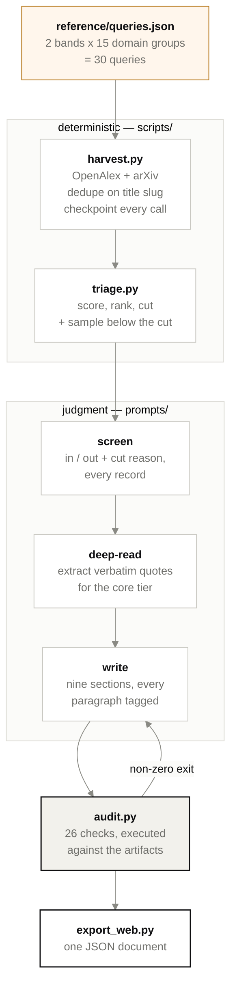
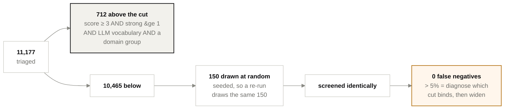

# Deep Research: Agentic AI in Geoscience

A scoping review of **LLM-based agentic AI in solid-earth and subsurface
geoscience**: what has been built, how it was evaluated, and how mature it is.

[](https://github.com/jannablaume/deep-research-agentic-geoscience/actions/workflows/ci.yml)
[](./LICENSE)
[](https://www.python.org/downloads/)
[](./pyproject.toml)
[](https://docs.astral.sh/ruff/)
[](https://mypy-lang.org/)
[](https://pre-commit.com/)

**Descriptive only.** No gap analysis, no research agenda, no claim about where
the field should go next. The one thing it will tell you about an absence is that
a particular query looked for something and did not find it — and it cites the
query.

---

## Quickstart

Nothing below needs an API key, a harvest, or a network connection. The
irreplaceable artifacts are committed, so a clone can re-check the published
numbers for itself.

```bash
git clone https://github.com/jannablaume/deep-research-agentic-geoscience
cd deep-research-agentic-geoscience

make verify                       # re-audit all three runs against their artifacts
make export && make web           # build the dashboards
open web/dist/index.html          # xdg-open on Linux, start on Windows
```

`make verify` re-executes each finished run's contract audit against the files
committed beside it. On a fresh clone it reports:

```
outputs/01_landscape/v0.5                  PARTIAL  (3 of its checks need the gitignored harvest artifacts)
outputs/02_tango/v0.1                      PARTIAL  (3 of its checks need the gitignored harvest artifacts)
outputs/03_gaps/v0.1-run2                  PASS
VERIFY_PARTIAL — every check that could run passed.
```

**`PARTIAL` is the honest answer, not a degraded one.** `screened.csv` and
`triage.csv` are 22 MB each and gitignored by design, and exactly three checks
per run cannot run without them — the other 23 of 26 (and 35 of 38 for `02`)
do. A run is `PARTIAL` only when the failing set is *exactly* that trio; one
more failure and it is a `FAIL`. The repository's own rule applies to its own
gate: a check that could not run must not look like one that passed, and must
not look like one that failed either.

Regenerate the two files with `make harvest` (needs an API key) and the same
command reports `PASS` — plus one more thing: that the regenerated `audit.md`
matches the committed one **byte for byte**, so a changed check cannot quietly
rewrite a finished run.

That is the reproducibility claim, and it is executed rather than asserted.

`make web` needs Node; everything else runs on a bare Python 3.11+.

| I want to… | Go to |
|---|---|
| read the findings | [the report](outputs/01_landscape/v0.5/report/index.md) |
| check a number | [Why you can check any number here](#why-you-can-check-any-number-here) |
| **use this on my own topic** | **[docs/adapting.md](docs/adapting.md)** |
| understand the design | [docs/architecture.md](docs/architecture.md) |
| change the code | [CONTRIBUTING.md](CONTRIBUTING.md) |
| drive it with an agent | [AGENTS.md](AGENTS.md) |

## The three runs

| Run | Asks | Output | Dashboard |
|---|---|---|---|
| **01_landscape** | What exists in agentic AI for solid-earth geoscience | [`v0.5`](outputs/01_landscape/v0.5) | `index.html` |
| **02_tango** | What exists that bears on making a simulator agentic | [`v0.1`](outputs/02_tango/v0.1) | `tango.html` |
| **03_gaps** | What the two finished runs record as missing | [`v0.1-run2`](outputs/03_gaps/v0.1-run2) | `gaps.html` |

Those three are the record. Anything else under `outputs/` — the `-test`
directories, and `02_tango/v0.2`, which is
[superseded](outputs/02_tango/v0.2/SUPERSEDED.md) by `v0.1` — is kept because a
method that changed should be inspectable, not because its numbers mean
anything. `make verify` audits only the three.

---

## Start here

The current landscape is **v0.5**. Read in this order:

1. **[the report](outputs/01_landscape/v0.5/report/index.md)** — nine sections,
   `00_executive_summary` through `08_papers`
2. **[RUN.md](outputs/01_landscape/v0.5/RUN.md)** — how the run was done, its
   closing numbers, and what broke
3. **[reference/SCHEMA.md](reference/SCHEMA.md)** — the columns, the tiers, and
   the maturity rubric every claim is graded against

**Or read it as a dashboard** — the same report with each section beside the
counts it describes, its evidence tags as filters, and the verbatim quote behind
every characterisation one click away. Two commands, no server, and the folder
is sendable as-is: see [docs/dashboard.md](docs/dashboard.md).

## Where v0.5 landed

| | |
|---:|---|
| **11,191** | unique records harvested from OpenAlex and arXiv |
| **712** | shortlisted by `triage.py` — 6% of the corpus |
| **10,465** | below the cut, of the 11,177 the cut was applied to<sup>1</sup> |
| **151** | admitted after screening: **38 core**, 113 context |
| **150** | records screened from *below* the cut, to measure what the cut cost |
| **0** | false negatives found in that sample |
| **26/26** | contract checks passed, executed against the artifacts |
| **M4** | highest maturity demonstrated by anything in the corpus. **M5: 0** |

Core means the full text was read and every characterisation of it is backed by
a verbatim quote in `papers.md`. Context means it was counted and annotated, not
deep-read. `M5: 0` — nothing here is in routine use beyond a trial, evidenced by
somebody other than its authors — is a measurement, not an opinion.

---

## How a run works



Everything on the left is a script because none of it needs judgment; everything
in the middle is the model's because all of it does. The v0.1–v0.3 prompts asked
the model to do both halves and spent most of their length trying to stop it
drifting.

| Deterministic → a script | Needs judgment → the model |
|---|---|
| Search, paging, deduplication | Is this record in scope |
| Ranking and the shortlist cut | What does this system actually do |
| Every count and every share | Synthesis, and what the evidence supports |
| Contract compliance | Which subfield a general record belongs to |

The scripts use the **standard library only** — `urllib`, `csv`,
`xml.etree`. `git clone` plus any Python 3.11+ reproduces a harvest with nothing
installed. That is worth more here than the convenience of `requests`: a reviewer
who wants to re-run the corpus should not have to resolve a dependency tree
first.

## The cut is measured, not assumed

A shortlist is a claim that the records below it did not matter. That claim is
usually untested, and it is where a review quietly loses half its subject.



The cut is an **AND of four conditions**, which is why `triage_stats.md` reports
a grid over two knobs rather than one number. If a row is flat across
`min-score`, the score is not what is cutting and lowering it will change
nothing — twice now the binding filter has been structural rather than the score.

## Why you can check any number here

Nothing in the report stands on its own authority. Every claim carries its
evidential status as its first token, and the chain from a sentence to a
published page is three hops long.

```mermaid
%%{init: {
  'theme': 'base',
  'themeVariables': {
    'fontFamily': 'ui-sans-serif, -apple-system, Segoe UI, Helvetica, Arial, sans-serif',
    'fontSize': '14px',
    'primaryColor': '#FFFFFF',
    'primaryTextColor': '#0E0E10',
    'primaryBorderColor': '#C9C8C2',
    'lineColor': '#8A8A84',
    'textColor': '#0E0E10',
    'edgeLabelBackground': '#FBFBF9'
  }
} }%%
flowchart LR
    P["<b>a tagged sentence</b><br/><span style='color:#6F6F6B'>report/05_maturity.md<br/>[Certain] … [[doi:10.…]]</span>"]
    G["<b>papers.csv</b><br/><span style='color:#6F6F6B'>one row per admitted source,<br/>27 fixed columns</span>"]
    E["<b>papers.md</b><br/><span style='color:#6F6F6B'>the author's own words,<br/>quoted verbatim</span>"]
    U["<b>the source</b><br/><span style='color:#6F6F6B'>DOI or arXiv id</span>"]

    P -- "citation key" --> G -- "identity_key" --> E -- "source url" --> U

    style P fill:#F2F1EC,stroke:#0E0E10,stroke-width:1.5px
    style U fill:#FFF6EC,stroke:#B8791F,stroke-width:1px
```



| Tag | Means |
|---|---|
| `[Certain]` | Stated in a source that was read, and quoted in `papers.md` |
| `[Likely]` | Supported but inferred, or read from an abstract only |
| `[Absent-searched]` | Looked for and not found — **and it cites the query id that looked** |

`scripts/audit.py` enforces all of it by parsing the files rather than by asking:
every citation must resolve to a row in `papers.csv`, every core paper must have
an extract block, every substantive paragraph must carry a tag, every absence
claim must name a query, and no promotional wording may appear anywhere. It
exits non-zero, and it replaced a self-attested audit table — the one thing a
long compacted run cannot do is remember its own compliance.

`M5: 0` is what this machinery is for. It is a statement nobody can make honestly
from a reading list.

<sup>1</sup> The two totals differ by 14: the cut was applied to the API corpus,
and 14 grey-literature and snowball records were appended afterwards without
re-triage. `audit.py` allows those extras by name and fails on any other gap
between `triage.csv` and `screened.csv`, so the difference is checked rather
than assumed.

## Running it

```bash
make setup                                  # dev tooling and git hooks
```

Get a free [OpenAlex key](https://openalex.org) and put it in `.env`. It is
effectively required: OpenAlex meters a daily USD budget — $0.10 keyless, $1 with
a key — and a full harvest is ~300 search calls. Keyless, the run aborts partway
through. `harvest.py` refuses to retry a spent budget, because retrying turns one
loud failure into a quiet half-corpus that every later count trusts.

```bash
OUT=outputs/01_landscape/v0.6                # always a new directory

make plan  OUT=$OUT                          # the query plan, calls nothing
make smoke OUT=$OUT-test                     # 3 queries, one periphery group

make harvest OUT=$OUT                        # corpus, checkpointed every call
make triage  OUT=$OUT                        # shortlist + the below-cut sample
#   ... the model screens, deep-reads and writes ...
make audit   OUT=$OUT                        # executed contract check
make export  OUT=$OUT                        # one JSON document for the page
```

The loop is: edit the prompt or `reference/queries.json` → bump the version → run
→ inspect → commit the prompt and the output together.

**Two things that will cost you a day if you skip them.**

`--limit-queries N` is not a smoke test. The plan is core groups first and
periphery starts at q021, so six queries harvest ~1,900 records and zero
periphery — and `07_periphery.md` then cannot be written from harvest counts at
all. Use `make smoke`, which runs one periphery group on purpose.

Never point `triage.py` at a directory that already holds `screening.csv`. It
refuses unless `--force`, and that refusal is load-bearing: regenerating
`shortlist.md` and `audit_sample.md` underneath decisions made against the
previous pair leaves a run that looks finished and measures its recall against a
sample file no longer on disk. Two audit checks exist only to catch it.

> **Working with an agent?** Point it at **[AGENTS.md](./AGENTS.md)** and say
> what you want run. §A walks it through a research pass; §B is for changing the
> scripts. `CLAUDE.md` and `GEMINI.md` are pointers to the same file.

## The maturity rubric

The rubric is the review's most load-bearing judgment, so it is fixed in
[`reference/SCHEMA.md`](reference/SCHEMA.md) and every row is graded twice —
what the authors claimed, and what they demonstrated.

| | |
|---|---|
| **M0** | Position or architecture paper, no working implementation |
| **M1** | Implemented; evaluated only on synthetic or textbook-scale data |
| **M2** | Evaluated on a reusable, site-agnostic benchmark |
| **M3** | Evaluated on real field data from a named site, retrospectively |
| **M4** | Output entered a real workflow or influenced a real decision; site named, time-bounded |
| **M5** | Routine use beyond a trial, evidenced by somebody other than the vendor |

## Using it for your own research

The subject is geoscience, but nothing in `harvest.py` or the scoring knows
that. If you want a scoping review of another literature — with a shortlist cut
that is measured rather than assumed, and a report that cannot state a number
nobody computed — you can point this at your own field.

**[docs/adapting.md](docs/adapting.md) is the walkthrough.** The short version:

```bash
cp reference/queries_template.json reference/queries_mytopic.json   # annotated starter
$EDITOR reference/queries_mytopic.json                              # your two axes
python3 scripts/harvest.py --out outputs/04_mytopic/v0.1 --dry-run \
    --config reference/queries_mytopic.json                         # validate, call nothing
```

Copy the **02** run, not 01: 01's domain vocabulary is compiled into
`scripts/triage.py`, while 02's is read from its query plan, which is what makes
`harvest.py` and `triage_tango.py` reusable with no new Python at all. The audit
and export scripts need a fork — their controlled vocabularies are constants at
the top of each file, duplicated from the schema deliberately so that facet order
is stable across runs. `docs/adapting.md` has the file-by-file table.

The input contract is [`reference/SCHEMA_queries.md`](reference/SCHEMA_queries.md),
which had no documentation until it was needed for exactly this.

## Repository layout

| Path | What |
|---|---|
| `prompts/` | Versioned research prompts, broad → narrow |
| `.claude/skills/` | **Symlinks** into `prompts/`, so each prompt is a slash command |
| `reference/` | The contracts. `SCHEMA*.md` for what a run produces, `SCHEMA_queries.md` for the query plan that drives one, `queries*.json` for the plans themselves |
| `scripts/` | `harvest.py`, `triage.py`, `audit.py`, `enrich.py`, `export_web.py` (+ `_tango`/`_gaps` variants for the other two runs) |
| `web/` | The static dashboards — landscape, tango, gaps, one page each with a switcher between them. Astro; `dist/` opens from the filesystem, `src/data/*.json` is generated |
| `tests/` | Mirrors `scripts/`. `audit.py` is tested by mutation — see [AGENTS.md §B4](./AGENTS.md) |
| `outputs/<prompt>/<version>/` | One directory per run. **Never overwritten** |
| `decisions.md` | Decision log. Each entry says what it *rules out* |
| `docs/architecture.md` | Why it is shaped this way, and what looks wrong until you know why |
| `docs/adapting.md` | Pointing the machinery at a different literature |
| `docs/dashboard.md` | Building and reading the static pages |
| `CONTRIBUTING.md` | Conventions, what counts as a method change, what not to touch |

A committed run directory is **evidence**. `.editorconfig`,
`.pre-commit-config.yaml` and `pyproject.toml` all exclude `outputs/` so that no
formatter can ever trim whitespace inside one — a cosmetic diff on a run reads
like a method change, and a number edited to match a later recount is a rewritten
record. If a run's numbers are wrong, write a new version.

`screened.csv` and `triage.csv` are gitignored: 22 MB each, and they regenerate
from `reference/queries.json` in minutes. `screening.csv`, `papers.csv` and
`papers.md` are the irreplaceable ones.

## Reading it as a dashboard


Each run also builds a static page: the report with every section beside the
counts it describes, evidence tags as filters, all sources filterable and
downloadable as CSV, and the verbatim quote behind every characterisation one
click away.

```bash
make export && make web        # → web/dist/index.html
```

`web/dist/` is **not** committed — it is generated from a committed run and
regenerates in seconds. It opens by double-clicking, with no server and nothing
fetched at runtime, so a copy of the folder is a copy of the data and you can
zip it and email it.

`make export-tango` and `make export-gaps` add the other two pages; one
`make web` builds all three, each with a switcher to the others.

**Full details** — what the page adds over the markdown, the Node requirement,
why it is a folder and not a URL, and what to do when it opens unstyled — are in
**[docs/dashboard.md](docs/dashboard.md)**.

## Development

```bash
make check      # ruff, ruff-format, mypy --strict, pytest + coverage, hooks, symlinks
make verify     # re-audit every finished run against its committed artifacts
```

The two answer different questions. `make check` says the **code** is healthy;
`make verify` says the **published numbers** are still the numbers. Both run
from a bare clone with no network and no API key, and CI runs both.

`make check` must pass from a bare clone — no network, no API key, no run
directory — which is what makes CI meaningful. 385 tests, `mypy --strict` over
`scripts/` and `tests/`, and a coverage floor in `pyproject.toml` rather than on
the command line (at the default precision, `--cov-fail-under` compares the
*rounded* figure, so a run at 64.8% prints FAIL and then exits 0).

[`.github/workflows/ci.yml`](.github/workflows/ci.yml) runs the same gates
across Python 3.11–3.13.

Conventions, and which changes are **method changes** rather than refactors, are
in [CONTRIBUTING.md](./CONTRIBUTING.md).

A change to `triage.py`'s scoring is a **method change**: it alters what a re-run
admits, so it belongs in a version bump with a re-triage and a `decisions.md`
entry, never folded into a refactor. Three known scoring gaps are recorded as
`strict=True` xfails so they cannot be fixed by accident.

## Citing

See [CITATION.cff](./CITATION.cff). Cite the version you used — each directory
under `outputs/` is immutable and carries its own `RUN.md`.

## Licence

MIT for the scripts — see [LICENSE](./LICENSE). The report prose and the CSV
artifacts under `outputs/` are © 2026 Janna Blaume, released under
[CC BY 4.0](https://creativecommons.org/licenses/by/4.0/): reuse them with
attribution. Bibliographic metadata comes from
[OpenAlex](https://openalex.org) (CC0) and [arXiv](https://arxiv.org); abstracts
remain under their publishers' terms and are held here only as harvest
artifacts, which is why the two files carrying them in bulk are not committed.
